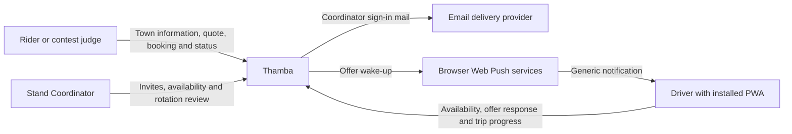
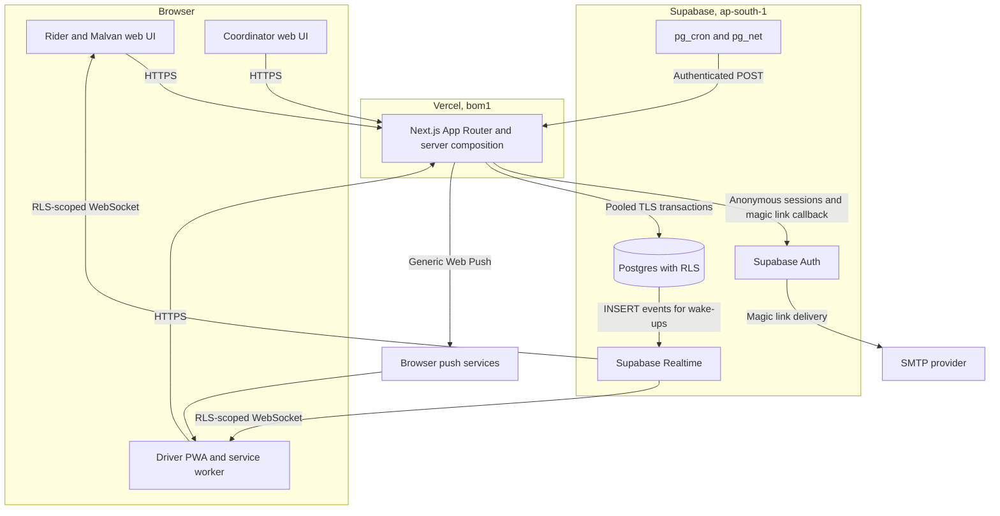
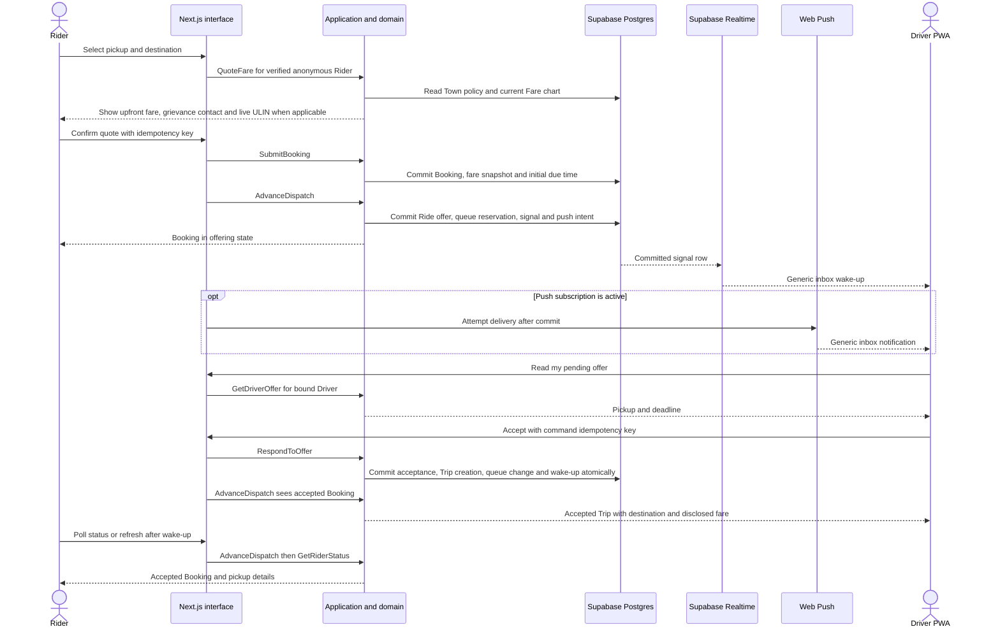

# Thamba architecture

## Open decisions

| Research tension | Recommendation for the contest and a future licensed pilot |
| --- | --- |
| Malvan must publish fixed fares and a Coordinator contact. The local tariff is unverified, and a booking or call-through service could connect real riders to drivers. | Publish stands, a fixed **illustrative** fare chart and a clearly labelled administrative Coordinator contact. Use a project-controlled contact for information and feedback until an official contact is verified and approved for publication. Keep Malvan information-only, with no ride-request or referral flow. Obtain the Sindhudurg RTA fare order and written approval of the proposed fixed, zero-fee model before live use. [Research brief](../01-understand/research-brief.md#3-regulation-and-the-zero-commission-pilot) |
| Stand FIFO, decline penalties and fallback may be affected by Rule 14(11) on differentiation before allocation and Rule 8(h) on admitting eligible permit holders. Field interviews are pending. | Run the published FIFO policies with synthetic drivers. Review queue exceptions with drivers and obtain written approval for rotation, eligibility, stand membership and pickup areas before choosing live policies. [Research brief](../01-understand/research-brief.md#3-regulation-and-the-zero-commission-pilot) |
| The specified Rules 14 and 16 features cover only part of the licensed service. The brief also identifies driver and vehicle checks, grievance staffing, security certification and an unresolved tracking-hardware question for autos. GPS tracking and several commercial features are outside contest scope. | Ship the specified app features in the demo. Keep the pilot closed until the authority and operator confirm the full requirements, including the application of the tracking rule, fare and receipt obligations, and whether the planned operating model fits the licence. [Research brief](../01-understand/research-brief.md#3-regulation-and-the-zero-commission-pilot) |

## Scope and platform

The contest release exposes a public, fictional Demo Town with synthetic Bookings, Landmarks and Drivers. Malvan is visible as **Licence pending**. Riders can request and complete a simulated Trip. Coordinators can manage a simulated Stand and review its rotation history. Payments, commission, surge, GPS tracking and native apps are outside scope. [Problem definition](../01-understand/problem-definition.md#contest-scope)

Use one pnpm project with strict TypeScript, Next.js App Router on Vercel, and Supabase Postgres, Auth and Realtime in Mumbai (`ap-south-1`). Run stateful Vercel Functions in Mumbai (`bom1`). The stable Next.js baseline checked on 24 November 2026 is **16.4.6**. Pin it and the pnpm version in M1, with a frozen lockfile in CI. Context7 supplied the App Router documentation for route handlers, Server Actions, Proxy and the manifest convention. Its latest indexed 16.4 patch was 16.4.5, so the release and npm tag establish the stable patch. [Next.js release](https://github.com/vercel/next.js/releases/tag/v16.4.6) · [npm latest tag](https://registry.npmjs.org/next/latest) · [App Router documentation](https://nextjs.org/docs/app) · [Supabase regions](https://supabase.com/docs/guides/platform/regions) · [Vercel regions](https://vercel.com/docs/regions)

## System context



## Containers



## Layers and import rules

| Layer | Owns | Allowed dependencies |
| --- | --- | --- |
| Domain | `Town`, `Booking`, `RideOffer`, `Trip`, Stand queue and Fare chart rules, typed errors, and dispatch policy interfaces and implementations | Domain modules and pure TypeScript built-ins. Time, generated identifiers and any simulated inputs are values passed in. |
| Application | One use case per module, command and read projections, actor scopes, repository and transaction ports, and clock and notification ports | Domain and other application contracts. Orchestration across use cases uses narrow callable ports. |
| Infrastructure | Supabase Auth and Postgres adapters, in-memory adapters, Realtime, Web Push, clock, telemetry and composition root | Application ports and domain types. Runtime libraries are allowed in adapters. |
| Interface | App Router route and action implementations, views, input validation, DTO presentation, locale and PWA behavior | Application contracts and local interface modules. Application projections carry all screen eligibility and presentation data. |

The infrastructure composition root is the outermost module. It constructs strategies, adapters and use cases, then injects the resulting endpoints and client capabilities into interface factories. Thin framework-discovered `src/app` entries are part of this wiring and call composed handlers or views. Actual route, action and presentation logic lives in `src/interface`. Browser wiring has its own entry under the same composition root and bundles public Realtime configuration only. Server-only modules and their credentials stay in the Node.js graph. [Next.js Server and Client Components](https://nextjs.org/docs/app/getting-started/server-and-client-components)

Dependency-cruiser runs in CI with resolved TypeScript aliases and type-only imports included. Allow-list each layer's internal edges and the composition entry paths. Reject cycles, cross-imports between interface and infrastructure adapters, imports of the root from a layer, and transitive browser dependencies on server-only modules. Forbid all external and Node imports in the domain and restrict application dependencies to the core. Compile the core without browser or Node ambient globals and lint direct time and I/O access. Add rule fixtures for forbidden imports through an alias, a barrel and a client dependency chain.

| SOLID principle | Enforcement |
| --- | --- |
| SRP | Each use case has its own module, such as `SubmitBooking`, `RespondToOffer` and `AdvanceDispatch`. |
| OCP | The domain defines `DispatchRanking`, `DeclinePenalty` and `StandFallback`. New policies implement these interfaces. The composition root supplies the policies, and domain rules constrain eligibility and transitions. |
| LSP | Every repository port, including read projections and due-work scans, has in-memory and Supabase adapters running the same behavioral contract suite. The transaction port has an equivalent suite. |
| ISP | Ports expose only operations used by one caller or a group with the same needs. A rider status reader, a driver offer reader and a dispatch writer have distinct capabilities. |
| DIP | Use cases receive ports. Concrete adapters, strategy selection and endpoint binding occur in the composition root. |

### Planned folder tree

```text
src/
  app/                             # Framework entry points for composition
    [locale]/
      towns/[slug]/
      (rider)/rider/
      (driver)/driver/
      (coordinator)/coordinator/
    api/rider/status/route.ts
    api/internal/dispatch/sweep/route.ts
    auth/callback/route.ts
    manifest.ts
  proxy.ts                         # Locale routing and session cookie refresh
  domain/
    shared/                        # Result, domain errors, branded IDs and shared value objects
    town/                          # Licence, booking capability, simulation profile
    fares/
    dispatch/                      # Booking, RideOffer, Stand queue and strategies
    trip/
    identity/
  application/
    use-cases/                     # One named use case per file
    ports/
    projections/
  infrastructure/
    composition/
    supabase/                      # Auth, transactions, repositories and Realtime
    memory/
    push/
    clock/
    observability/
  interface/
    routes/
    actions/
    ui/{rider,driver,coordinator}/
    pwa/
    i18n/
messages/{mr,hi,en}/{common,rider,driver,coordinator}.json
public/                            # PWA service worker and install assets
supabase/
  migrations/
  seed/
tests/{unit,property,contract,integration,e2e}/
```

## Domain model and operating rules

### Town, licence and fares

- `Town.bookingMode` is `simulated | live`. The domain evaluates booking capability against an injected `now`. It yields a booking context for a synthetic simulation profile or for a Town with a current licence, or yields an information-only view and reason. Malvan has neither a simulation profile nor a licence. Its persisted mode is `simulated`, with no authority to simulate. The fictional Demo Town has both `simulated` mode and a synthetic profile.
- Live mode can be set only with a current licence holding the Town's ULIN, issuing authority and validity dates. The domain also rechecks the licence on every new quote, booking, offer allocation and acceptance, so a previously valid record can become information-only. Date-only licence ranges are inclusive in `Asia/Kolkata`, represented by a start instant and an exclusive end at the following local midnight. Pass instants in UTC. A lapsed live licence closes pending dispatch and prevents new assignments. Previously accepted Trips can be viewed and closed out. Confirm that closeout procedure before a licensed pilot.
- A server-owned quote ties the Rider, Town or demo run, ordered Route, Fare chart version, INR amount in integer paise and expiry together. The Rider sees the fare before confirmation. Submission checks quote ownership, current capability and fare version. A stale quote returns a fresh quote for explicit confirmation. Store the disclosed fare and version on the Booking so later chart edits cannot change the accepted fare.
- Route components render the domain-derived town and booking projections and display the localized grievance contact on every booking screen, including quoting, confirmation, status, offer and trip views. A current live context carries the ULIN for display in the public Town and booking layouts. The application maps domain outcomes into these projections and takes the same domain path for direct requests, polls and scheduled actions. All core flows and seeded names and pickup cues are available in Marathi, Hindi and English. [ADR 0005](../adr/0005-localisation.md)

### Dispatch and Trip lifecycle

- Booking states are `scheduled`, `requested`, `offering`, `accepted`, `driver_arrived`, `in_trip`, `completed`, `cancelled_by_rider`, `cancelled_by_driver` and `no_driver_found`. The reasons for `no_driver_found` are `dispatch_deadline`, `booking_unavailable` and `stands_exhausted`. Acceptance creates the active Trip (`TripCreated`). Confirming pickup moves the Booking to `in_trip` and emits `TripStarted`. [Booking state machine](specs/dispatch.md#booking-state-machine)
- Rank eligible Drivers by ascending `queuedAt`, then by canonical `driverId` in ascending lexicographic order. Each Booking attempts a Driver at most once. The Town can configure the decline policy, which defaults to moving the Driver to the tail. [Fair rotation](specs/dispatch.md#fair-rotation)
- The Town's offer timeout defaults to 60 seconds. Each offer's `expiresAt` is the earlier of `issuedAt` plus the offer timeout and `dispatchDeadline`. A pending offer closed at or after `expiresAt` is recorded as `expired`. [Ride offer lifecycle](specs/dispatch.md#ride-offer-lifecycle)
- Scan the capped, ordered Stand list captured at request time within the same Town and run, starting with the original Stand. If the scan finds no eligible Driver, end immediately in `no_driver_found` with `stands_exhausted`. If dispatch reaches `dispatchDeadline` (90 seconds after `requestedAt` by default), it ends in `no_driver_found` with `dispatch_deadline`. [Stand fallback and search deadline](specs/dispatch.md#stand-fallback-and-search-deadline)
- Begin testing with a 3-second visible poll, then tune against the seeded runs.
- Each visitor can start an isolated Demo Town run with one fictional Stand and roster. A server-side simulator advances a seed-defined Driver script via the same response, pickup and completion commands. Its trusted actors are limited to synthetic fixtures in that run. Rider polling and the sweep can run due script steps with stable command IDs. Public scenarios include a successful Trip and queue exhaustion. The human-operated PWA path uses a synthetic Driver profile bound with a normal invite.

## Persistence, auth and trust boundaries

| Data | Database enforcement | Access |
| --- | --- | --- |
| Towns, licences, simulation profiles, Stands, Landmarks, Routes and fares | Scoped foreign keys, date and amount checks, unique route and Fare chart versions | Public Town details are served as a curated server projection. System provisioning owns mode, licence and fares. |
| Bookings, Ride offers, Trips, Driver roster, queue and audit events | Scoped foreign keys, status shape checks, partial unique indexes on pending offers by Booking and by Driver, one Trip per Booking and at most one active Trip per Driver, unique queue membership and `version` on mutable state. A single versioned Driver slot enforces that an offer and Trip cannot reserve the same Driver simultaneously. | Riders read their own Booking and Trip projections. Drivers read their own pickup-only offers and assigned Trips. Coordinators see their Stand's operational views and queue history. |
| Role memberships, Driver bindings, invites and demo runs | Unique active Driver binding and session binding, unique token digest, invite validity shape and version, isolated demo run references | Authorised membership reads and narrowly scoped invite commands. Invite digests are server-only. |
| Quotes, command records, Realtime signals and push outbox | Actor-scoped command idempotency key and request fingerprint, unique event and delivery IDs, indexed due times | Scoped quote and command reads. Realtime recipients can read their own signals. Push endpoints and outbox data are restricted to server capabilities. |

Enable RLS on every Thamba table in every schema, with default denial and separate grants for each access path. Owner and migration credentials are deployment-only. The app uses non-owner, non-`BYPASSRLS` Postgres roles. A request reader uses verified actor and scope. A scoped command writer may update the participating records in an application-authorized Town or run and Stand transaction. A narrow system role scans due work and opens separately scoped command transactions. The adapter sets transaction-local scope and rejects missing scope. Browser policies on the published signal table use the Supabase JWT recipient identity. Browser roles have no operational table write grants. Verify both database and API access with real roles. [ADR 0002](../adr/0002-supabase.md)

Each command computes a transition in TypeScript and commits state, queue versions, audit and notification intent in a short pooled Postgres transaction. Version-conditional updates compare expected versions for the Booking, Offer, Driver or Stand queue as needed. Read the current Town policy and Fare chart consistently with writes so a concurrent config change forces a retry or serializes against the mutation. On stale state or a known uniqueness race, reload and reevaluate with a fresh clock value. A unique actor-scoped idempotency key returns the committed result after a lost response and rejects mismatched reuse. SQL constraints and atomic writes enforce invariants. Rate, expiry, licensing, eligibility, ranking and fallback are TypeScript rules. A persisted `next_due_at` is an indexable work hint computed by the application.

Riders and Drivers obtain Supabase anonymous sessions. A Driver can act only after an anonymous session redeems a Coordinator-issued, single-use invite for a scoped roster entry. Coordinators use email magic links and require a pre-provisioned active Stand membership. Verify the session and resolve current membership at the server boundary for every protected operation. The application derives Driver privileges from the active binding. [ADR 0003](../adr/0003-anonymous-sessions-and-invites.md)

The pre-accept Driver projection carries pickup and deadline only as route-specific facts. Omit destination, Route ID, fare and Rider details from pending offers, rendered payloads, browser caches, Realtime and push. Fetch the accepted Trip through a separately authorized projection after the acceptance commits. Publish only recipient-scoped generic wake-ups through Realtime Postgres Changes. Web Push uses a generic notification and a private inbox link. Try delivery promptly after commit within the request budget and retry through the sweep while the offer is current. The Driver PWA installs from the App Router manifest and caches only its static shell and public assets. Reconnect or foregrounding refetches current state. A visible inbox can poll if the socket is unavailable. Offline actions require reconnection and fresh confirmation. [Next.js PWA guide](https://nextjs.org/docs/app/guides/progressive-web-apps) · [Supabase Postgres Changes](https://supabase.com/docs/guides/realtime/postgres-changes)

## Rider books → Driver accepts



## Dispatch expiry

`AdvanceDispatch` is idempotent and deadline-driven. It runs after the first Booking commit, on an authorized Driver response, on the Rider's status poll and from a `pg_cron` + `pg_net` sweep to a protected Vercel route. A poll uses `POST /api/rider/status` because it can advance state. The sweep calls `POST /api/internal/dispatch/sweep` with a separate machine token and processes bounded due work oldest first. No request sleeps until expiry. Failed calls leave persisted work available to the next trigger. [ADR 0004](../adr/0004-offer-expiry.md) · [Supabase pg_net](https://supabase.com/docs/guides/database/extensions/pg_net)

## Errors and recovery

Domain and application return discriminated `Result<T, E>` values, including clock-dependent rejection and expected conflicts. Infrastructure catches driver, network and provider exceptions, maps known failures into typed port errors, and reports unknown failures using redacted context. Infrastructure edges are the only place exceptions can arise or propagate before translation. An interface boundary maps a typed result to a localized view, form result or HTTP response. It renders a generic retry or unavailable view for unexpected failures.

| Error | HTTP or UI behavior |
| --- | --- |
| Invalid input | 400 with localized field errors. |
| Missing session or wrong authenticated role | 401 or 403. Return 404 for a missing or out-of-scope Booking or Offer to avoid exposing existence. |
| Booking unavailable or town policy changed | 409 with the current capability view. |
| Quote stale, offer expired or conflicting action | 409 with a fresh quote or state. A response at expiry may advance another offer and still returns expired to that Driver. |
| Rate limit | 429 with a retry delay. |
| Database, Auth or dependency failure | Safe 503 response with a correlation ID. User retries reuse the command key. Notification retries are independent of the committed transition. |

Authenticated pages, callback responses and status endpoints use private, no-store responses and dynamic rendering where needed. Validate cookie-scoped sessions and origin on state-changing calls. Give machine ingress a separate token, allow only POST and enforce bounded execution. Mobile clients preserve form input across transient failure and use server state as the authority for countdowns and acceptance. [Next.js Route Handlers](https://nextjs.org/docs/app/getting-started/route-handlers)

## Configuration and secrets

| Location | Values |
| --- | --- |
| Build and public configuration | Locked Next.js, Node.js and pnpm baseline, strict TypeScript, Vercel `bom1`, public HTTPS origin, `NEXT_PUBLIC_SUPABASE_URL`, `NEXT_PUBLIC_SUPABASE_PUBLISHABLE_KEY` and `NEXT_PUBLIC_VAPID_PUBLIC_KEY`. Only public values may enter browser bundles. |
| Vercel server-only environment | `DATABASE_READER_URL`, `DATABASE_WRITER_URL`, `DATABASE_SWEEP_URL` for restricted pooler identities, `DISPATCH_SWEEP_TOKEN`, `VAPID_PRIVATE_KEY`, `VAPID_SUBJECT` and any telemetry credentials. Use a small pool with TLS and prepared statements disabled for Supavisor transaction mode. |
| Supabase project and Vault | Mumbai `ap-south-1`, anonymous sign-in and abuse controls, coordinator magic-link callback allow-list and SMTP credentials, Realtime publication, `pg_cron` and `pg_net`. Vault stores the per-environment sweep token and target origin. CI migration and Auth admin credentials have dedicated deployment and test scopes. |
| Versioned application policy and data | Offer and dispatch timings, batch caps, quote and invite TTLs, rate limits, simulation fixtures, localized public contacts, Fare charts and Town licence records. Validate configuration at startup. Resolve booking authority from the Town and time. |

Use isolated local, preview and production identities and data. Preview and production contest seeds contain synthetic dispatch data only. Rotate machine tokens by briefly accepting old and new values, switching Vault, then retiring the old token. Keep secret values out of seeds, build outputs, browser payloads and logs. [Supabase connection modes](https://supabase.com/docs/guides/database/connecting-to-postgres) · [Supabase Vault](https://supabase.com/docs/guides/database/vault)

## Observability without PII

- Use structured events with a generated, short-lived request correlation ID, route template, actor class, outcome code, latency, dispatch trigger and release. Use aggregate metrics for booking-to-accept latency, expiry and `no_driver_found`, queue conflicts, sweep health, oldest due age, Realtime reconnects and push failures.
- Capture only allow-listed fields. Exclude account, Booking and Trip identifiers, emails, phone numbers, IP addresses, Landmarks, Route data, push endpoint URLs, invite tokens, headers, cookies, bodies, query strings and raw provider errors. Configure platform log and tracing access, sampling and retention. Test redaction with synthetic values and scan exported logs.
- Store operational audit records separately in Postgres with scoped access. Record synthetic or internal references, queue order, state transitions and reason codes so a Coordinator can reconstruct a turn. Aggregate or delete demo run data on the planned retention schedule. Review the live retention and access policy before collecting live data. [Research brief on privacy](../01-understand/research-brief.md#5-rider-and-driver-phone-numbers-under-dpdp)
- Alert on two missed one-minute sweep intervals, increasing oldest-due age and sustained database or push error rates. Inspect the last successful HTTP response and resulting backlog. A successful cron SQL enqueue alone is insufficient evidence of a successful dispatch sweep.

## Decisions and delivery

[Architecture style](../adr/0001-architecture-style.md) · [Supabase](../adr/0002-supabase.md) · [Sessions and invites](../adr/0003-anonymous-sessions-and-invites.md) · [Offer expiry](../adr/0004-offer-expiry.md) · [Localisation](../adr/0005-localisation.md) · [Tests](../adr/0006-test-strategy.md) · [Roadmap](roadmap.md)
