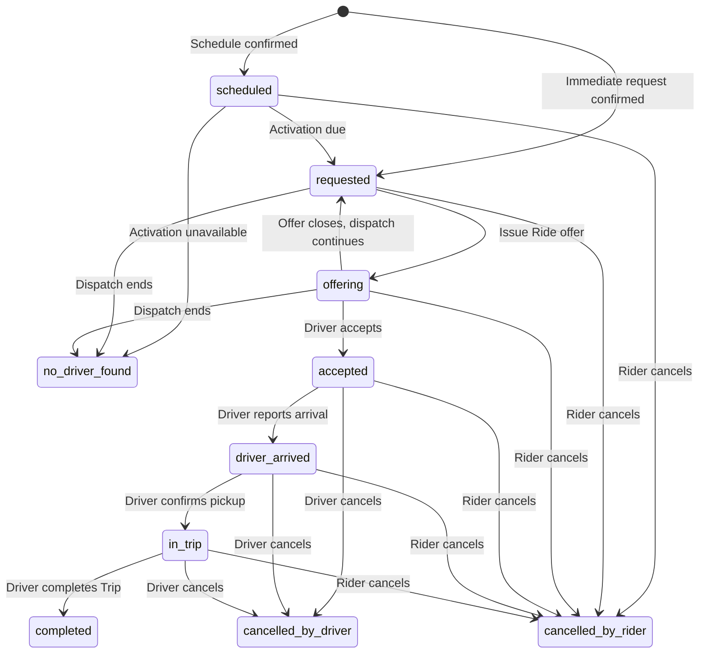

# Dispatch specification

This specification is the source of truth for dispatch states, timing, rotation, fallback and outcomes. The contest uses synthetic Bookings, Drivers, Stands and contacts in isolated Demo Town runs. Malvan remains information-only. [Architecture](../architecture.md) · [Problem definition](../../01-understand/problem-definition.md)

## Booking state machine

`completed`, `cancelled_by_rider`, `cancelled_by_driver` and `no_driver_found` are terminal. A Trip begins at acceptance and occupies the Driver through arrival and pickup until completion or cancellation. An early end by either party uses that party's cancellation state, including after pickup. A Driver who passes on a pending offer declines it.

`now` is the authoritative decision time in UTC, sampled within the serialized decision or refreshed when a retry reevaluates it. Client clocks and message arrival timestamps have no authority over deadlines. Every actor is authorized for the affected Booking, Driver, Town and demo run as applicable. Dispatch is a trusted system actor. A simulator may act as a Driver only for its own synthetic fixtures and uses the same guards.

| ID | From → to | Trigger and actor | Guards and effects | Domain events |
| --- | --- | --- | --- | --- |
| B1 | Initial → `scheduled` | Rider confirms a scheduled pickup | Valid, Rider-owned quote for the current Fare chart and applicable Town or demo run. Town can book at `now` and `pickupAt > now`. Record the Rider-confirmed fare terms and `requestDueAt`. | `BookingScheduled` |
| B2 | Initial → `requested` | Rider confirms an immediate pickup | Same authority and quote checks as B1. Set `requestedAt`, freeze the fare and make dispatch due. | `BookingRequested` |
| B3 | `scheduled` → `requested` | Dispatch activates a due schedule | `now >= requestDueAt` and Town can book at `now`. Set `requestedAt`, freeze the Rider-confirmed fare and make dispatch due. | `BookingRequested` |
| B4 | `scheduled` → `no_driver_found` | Dispatch evaluates a due schedule | `now >= requestDueAt` and Town cannot book at `now`. Close with reason `booking_unavailable`. | `BookingNoDriverFound` |
| B5 | `requested` → `offering` | Dispatch issues an offer | Town can book, `now < dispatchDeadline`, and the selected Driver is first under the eligibility, rotation and fallback rules. Reserve the Driver and record the attempt. | `RideOfferCreated` |
| B6 | `offering` → `requested` | Driver declines, Dispatch expires an offer, or the Driver or Stand Coordinator takes the Driver out of rotation | Close the current pending offer with the outcome below and release its reservation. Town can still book and `now < dispatchDeadline`. Make dispatch due again under the original `requestedAt` and `dispatchDeadline`. | One of `RideOfferDeclined`, `RideOfferExpired`, `RideOfferWithdrawn` |
| B7 | `offering` → `accepted` | Offered Driver accepts | Own current pending offer, Driver is online at the offer's Stand and its reservation occupies the Driver's slot, Town can book, and `now < expiresAt` and `now < dispatchDeadline`. Accept the offer, remove the Driver from rotation and create the active Trip atomically. | `RideOfferAccepted`, `BookingAccepted`, `TripCreated` |
| B8 | `accepted` → `driver_arrived` | Assigned Driver reports arrival | Driver owns the active Trip. Record arrival at the pickup Landmark. | `DriverArrived` |
| B9 | `driver_arrived` → `in_trip` | Assigned Driver confirms pickup | Driver owns the active Trip. Record pickup. | `TripStarted` |
| B10 | `in_trip` → `completed` | Assigned Driver completes Trip | Driver owns the active Trip. End the Trip and release the Driver's slot. | `TripCompleted` |
| B11 | `requested` → `no_driver_found` | Dispatch ends the search | First applicable reason in order is `dispatch_deadline` at `now >= dispatchDeadline`, `booking_unavailable` if the Town cannot book, or `stands_exhausted` under the fallback rules. | `BookingNoDriverFound` |
| B12 | `offering` → `no_driver_found` | Dispatch advances, or a response or availability change reveals that dispatch must close | Dispatch deadline reached or Town cannot book. Use B11's reason order and close the pending offer atomically. | `RideOfferExpired` or `RideOfferWithdrawn`, then `BookingNoDriverFound` |
| B13 | `scheduled`, `requested`, `offering`, `accepted`, `driver_arrived` or `in_trip` → `cancelled_by_rider` | Booking's Rider cancels | Close any pending offer and release its reservation. End any active Trip and release the Driver's slot. | `RideOfferWithdrawn` or `RideOfferExpired` if an offer closes, then `TripCancelled` if a Trip ends, then `BookingCancelledByRider` |
| B14 | `accepted`, `driver_arrived` or `in_trip` → `cancelled_by_driver` | Assigned Driver cancels | Driver owns the active Trip. End the Trip and release the Driver's slot. | `TripCancelled`, `BookingCancelledByDriver` |

State changes, reservations, Trip records, queue effects and event records commit as one decision. An event named in both lifecycle tables is emitted once. Events record occurrence time, actor, scoped entity IDs and applicable reason. The rotation history also records the Stand, attempted Driver, eligibility and order at selection, and the prior and resulting queue entry or reservation for each affected Driver. Publish wake-ups after commit. An authorized response may return a rejection after committing a due expiry or dispatch closeout.

## Request time, scheduling and fares

- A Town can book in `simulated` mode with a synthetic simulation profile and matching run, or in `live` mode with a licence valid at the decision time. Licence validity includes the start instant and excludes the end instant. Date-only ranges end at local midnight immediately following the last valid day in `Asia/Kolkata`. Check authority at quote, schedule submission, entry to `requested`, offer allocation and acceptance. A loss of authority closes pending dispatch with `booking_unavailable`. An already assigned Trip can progress or close out.
- The Town's scheduling lead time defaults to **20 minutes**. At schedule creation, set `requestDueAt = pickupAt - leadTime` using that Town's lead time. A schedule confirmed within the lead window is due immediately. The first advancement at or after `requestDueAt` attempts activation. Set `requestedAt` to the actual activation decision time, including when a sweep runs late. The same `requestedAt` rules apply to immediate requests at confirmation.
- A quote binds the Rider, Town or demo run, ordered Route, Fare chart version, INR amount in integer paise and quote expiry. Check ownership, expiry and the current Fare chart when the Rider confirms. An expired or superseded quote requires a fresh quote and explicit Rider confirmation. At the first entry to `requested`, freeze the confirmed Route, amount and Fare chart version for the life of the Booking and its Trip. Scheduled activation uses the terms validated at schedule confirmation. Subsequent retries and fallback offers use the frozen terms.

## Ride offer lifecycle

Each Town can configure a positive offer timeout, defaulting to **60 seconds**. At creation set `expiresAt = min(issuedAt + townOfferTimeout, dispatchDeadline)`. Each offer retains its deadline through config changes. While dispatch remains open, a pending offer is actionable at `now < expiresAt` and due at `now >= expiresAt`. The time guard applies even before Dispatch records its expiry. On `ExpireOffer(offerId)`, the caller applies B6 and O4 atomically before replanning from the original Stand. If dispatch must close, the caller applies B12. When a command closes a pending record at or after `expiresAt`, record `expired`. Earlier closure uses the outcome below. A response that discovers a due pending offer reports expiry to the Driver even if it advances the Booking. All four outcomes are terminal for the offer.

| ID | From → to | Trigger and actor | Guards and effects | Domain event |
| --- | --- | --- | --- | --- |
| O1 | Initial → `pending` | Dispatch issues an offer | B5. The offer belongs to one Booking, Driver and Stand. Record that this Driver has been offered this Booking. | `RideOfferCreated` |
| O2 | `pending` → `accepted` | Offered Driver accepts | B7, including both deadline guards. Convert the reservation to an active Trip. | `RideOfferAccepted` |
| O3 | `pending` → `declined` | Offered Driver declines | Own current offer, `now < expiresAt`, and Town can still book. Release the reservation and apply the decline policy. | `RideOfferDeclined` |
| O4 | `pending` → `expired` | Dispatch advances, or a response, cancellation or availability command closes a due offer | `now >= expiresAt`. Release the reservation and apply the expiry rotation rule. | `RideOfferExpired` |
| O5 | `pending` → `withdrawn` | Rider cancels, Driver or Stand Coordinator takes the Driver out of rotation, or Dispatch closes for loss of Town authority | `now < expiresAt` and the relevant cancellation, availability or authority guard holds. Release the reservation and apply the withdrawal rotation rule. Record the reason. | `RideOfferWithdrawn` |

The Driver's pending-offer view contains the pickup Landmark, pickup cue and deadline as its route-related details. The destination, Route ID, fare and Rider details stay out of pre-accept reads, events delivered to Drivers, notifications and retained client data. An authorized Trip view exposes destination and fare to the assigned Driver after acceptance commits.

## Fair rotation

The Booking has an original Stand and searches one Stand at a time. A Driver is eligible at the Stand currently being searched when they are online in that Stand's rotation, have no active Trip or pending offer, and have never been offered this Booking. The attempt counts from offer creation regardless of outcome or later Stand membership. Rank eligible Drivers by `queuedAt` ascending and then by canonical `driverId` in ascending lexicographic order.

`queuedAt` is a queue ordering time. To append at the tail, set it to `max(now, latestQueuedAt + 1 microsecond)` over all existing entries for the Stand, including entries reserved by offers. Use `now` if the Stand has no entries. The ordering time can be ahead of the decision time to give consecutive tail insertions a strict order. A queue entry is unique to the Driver in the dispatch scope. An entry is required to be online for dispatch. Going offline means leaving the rotation and is independent of connectivity or Trip access.

| Action | `queuedAt` and queue effect |
| --- | --- |
| Issue offer | Retain `queuedAt` and reserve the entry, which makes the Driver temporarily ineligible. |
| Accept | Clear `queuedAt` and remove the entry. The Driver leaves the rotation and the active Trip takes the slot. |
| Decline | Release the reservation. Apply the Town's pluggable decline policy to the available Driver's position. The default sets `queuedAt` by the tail rule. A configured policy may retain the position or move the Driver later in the same queue. The policy cannot change eligibility, attempt history, or the order of other Drivers. |
| Expire | Release the reservation and set `queuedAt` by the tail rule if the Driver remains online. If the same command takes the Driver offline, clear `queuedAt` and leave the Driver out of the rotation. |
| Withdraw | Retain the original `queuedAt` if the Driver remains online, restoring their place by the current queue order. Clear `queuedAt` if the withdrawal accompanies removal from rotation. |
| Complete Trip or cancel after acceptance | Clear the active Trip slot. The Driver remains out of rotation with `queuedAt` unset until they explicitly mark themselves available. |
| Online → offline, break, Coordinator skip, or walk-up | Remove the entry and clear `queuedAt`. Resolve any pending offer in the same decision. A Coordinator records a reason for a skip or walk-up. An active Trip continues to occupy its slot. |
| Offline → online | The Driver or Stand Coordinator explicitly marks the Driver available at their authorized Stand. Require an empty Driver slot. Create the entry with `queuedAt` set by the tail rule. Repeating the action while already online preserves `queuedAt`. |

Record reservation, release, queue position and membership changes in the rotation history. Emit one `DriverQueueChanged` per affected Driver in each decision, with the reason and all queue effects.

## Stand fallback and search deadline

- At request time, capture the ordered search list and dispatch time limit for the Booking. The list starts with the original Stand, followed by the configured neighbouring Stands that serve the pickup area in the same Town and run, with each Stand listed once. Search at most the first **N** distinct Stands, including the original Stand. The Town can set **N** to a positive integer. If the Town supplies no cap, use the full list. The one-Stand demo has an empty alternate list.
- Set `dispatchDeadline = requestedAt + T minutes`. The Town can configure positive **T**, defaulting to **1.5 minutes (90 seconds)**. At `now >= dispatchDeadline`, close dispatch, expire any pending offer and use `no_driver_found` with `dispatch_deadline`.
- On each search, scan only the ordered, capped Stand list captured at request time. From the same serialized snapshot as the queue, verify that each candidate Stand still serves the pickup area and belongs to the Booking’s Town and run. Skip any Stand that fails either check. Skipped Stands still count toward the captured cap. Later edits to neighbour order or cap apply to new Bookings.
- Each search in `requested` scans the captured list once in order, applying current Stand eligibility and rotation. Continue past any Stand without an eligible Driver, including when every Driver there has a pending offer for another Booking. Stop at the first eligible Driver and return `OfferTo(driverId)` for the original Stand or `EscalateToStand(standId, driverId)` for a neighbouring Stand. The caller issues one offer via B5 from the same serialized snapshot. If an offer closes and dispatch continues, the next search starts from the original Stand with the same attempt history.
- If the scan finds no eligible Driver across the capped list, return `GiveUp(stands_exhausted)`. The caller applies B11 immediately.
- In `no_driver_found`, show the original Stand Coordinator's configured public contact to the Rider. Preserve the configured text and link dialable numbers with `tel:`. In a demo run, show the labelled synthetic contact. If booking authority has lapsed, show it as an administrative contact and present the current Town capability reason.

## Dispatch planner contract

The planner evaluates `requested` and `offering` Bookings with Town authority sampled at `now` within the serialized decision. It returns `GiveUp(dispatch_deadline)` at `now >= dispatchDeadline`. Before the deadline it returns `GiveUp(booking_unavailable)` if Town authority has lapsed. The caller applies B11 for `requested` or B12 for `offering`.

While dispatch remains open, the planner returns `WaitForResponse(expiresAt)` for an actionable pending offer or `ExpireOffer(offerId)` for a due pending offer. The caller applies B6 and O4 atomically on `ExpireOffer(offerId)` before replanning from the original Stand.

Each search scans the captured list once. The planner returns `OfferTo(driverId)` for the first eligible Driver at the original Stand or `EscalateToStand(standId, driverId)` for the first eligible Driver at the first eligible neighbouring Stand. Both results authorize one allocation from the same serialized snapshot. If the scan finds no eligible Driver, the planner returns `GiveUp(stands_exhausted)`.

| Result | Decision |
| --- | --- |
| `OfferTo(driverId)` | Allocate to the selected Driver at the original Stand. |
| `EscalateToStand(standId, driverId)` | Allocate to the selected Driver at the specified neighbouring Stand. |
| `WaitForResponse(until)` | Wait for the pending offer's response until `expiresAt`. |
| `ExpireOffer(offerId)` | Expire the due offer and return the Booking to `requested` before replanning. |
| `GiveUp(reason)` | End dispatch with `dispatch_deadline`, `booking_unavailable` or `stands_exhausted`. |

### Planner assumptions

- At request or scheduled activation, the caller supplies neighbours already verified to serve the pickup area in the Booking's Town and run. Capture removes repeated Stand IDs before applying the cap, and rejects an explicitly configured cap that is not a positive safe integer.
- Stand eligibility, queue entries, active Trip slots and offer attempts come from the same serialized decision. The queue and slots are scoped to the Booking's Town and run. A captured Stand with no current eligibility record is skipped, including the original Stand. An offer attempt still counts if the Driver has since moved to another Stand.
- Booking decisions keep millisecond precision. Queue order uses integer epoch microseconds so consecutive tail insertions can differ by one microsecond at the same decision time.
- A decline policy can choose a queue time from the Driver's current position through the calculated tail, inclusive. An out-of-range result uses the default tail placement.
- The caller invokes the planner only for `requested` and `offering` Bookings. Input outside those states, or an `offering` Booking missing its pending record during an open dispatch window, produces `GiveUp(booking_unavailable)` without authorizing a new offer. The Booking transition guards still apply.

## Invariants

| ID | Rule |
| --- | --- |
| I1 | First entry to `requested` requires `simulated` mode with a valid synthetic context, or `live` mode with a licence valid at `requestedAt`. Allocation and acceptance independently require current Town authority. |
| I2 | A Driver never sees the destination of a pending offer. All pre-accept surfaces also omit the Route ID, fare and Rider details. |
| I3 | A Booking has at most one pending offer. Only `offering` has a pending offer record, including a due record awaiting reconciliation. |
| I4 | A Driver has at most one pending offer, at most one active Trip, and at most one of these two reservations combined. A Booking has at most one Trip. |
| I5 | An offer can be accepted only from `pending`, strictly before both its own expiry and the dispatch deadline. A recorded `expired` offer can never be accepted. |
| I6 | The confirmed fare, Route and Fare chart version freeze at first entry to `requested` and are used by every later view or Trip that exposes the fare. |
| I7 | Terminal Bookings stay terminal. In particular, a cancelled Booking never gets a new offer and has no pending offer or active Trip. |
| I8 | Every allocated Driver is the first eligible Driver by `(queuedAt, driverId)` at the first eligible Stand in search order. Each Driver receives at most one offer per Booking. |
| I9 | Queue membership and `queuedAt` follow the rotation rules atomically. A Driver has at most one entry, an active Trip has no queue entry, and a pending offer reserves its online entry until resolution. |
| I10 | Scheduled Bookings enter `requested` at most once as an initial request and only at or after `requestDueAt`. Scheduled Bookings have no offers or Trips. |
| I11 | Fallback stays within the capped list in the original Town and run. No offers are issued at or beyond the dispatch deadline. A `no_driver_found` status exposes the original Stand Coordinator's configured contact. |
| I12 | A successful state-changing command emits its events once. Replays return the committed result for the same actor, command key and input. Reuse of that key with different input is rejected. |

## Concurrency and recovery

Enforce guards on current state and commit with version checks across the Booking, Offer, Driver slot and affected queue state. Include Town authority and any Stand eligibility read in the decision's consistency boundary. Use unique indexes for pending offers per Booking and per Driver, attempts per Booking and Driver pair, queue entries per Driver, one Trip per Booking, and active Trips per Driver. The versioned Driver slot ensures a pending offer and active Trip cannot coexist. On a stale version or uniqueness conflict, reload and reevaluate guards and time. A failed decision leaves its state, events and notifications uncommitted.

| Race | Expected outcome | Guarantee |
| --- | --- | --- |
| Accept vs expiry at the same instant | At `now == expiresAt`, expiry wins even if the acceptance command runs first. The Driver gets an expired outcome, the Trip is absent, and expiry advances or ends the search once. An acceptance already committed strictly before expiry stands. | Deadline domain guard, version checks on Offer, Booking and Driver slot, atomic closeout and unique Trip index. |
| Two sweeps for the same Booking | Both may discover the same work. One applies each due activation, expiry or allocation. The other reloads and observes the result or advances newly due work. One pending offer remains at most. | Version checks, pending-offer unique indexes, and idempotent domain guards and event commit. |
| Two Bookings want the same Driver | The first committed reservation wins. The other allocation recomputes eligibility and rank, and may pick the next eligible Driver. | Versioned Driver slot and Stand queue, pending-offer unique index per Driver, and eligibility guard on retry. |
| Rider cancels while an offer is pending | Cancellation before expiry withdraws the offer and releases the Driver at their retained queue position. At expiry, the offer closes as expired and applies the expiry rotation rule. If acceptance committed first, Rider cancellation ends the assigned Trip. Every successful cancellation is terminal. | Rider ownership and terminal guards, Booking, Offer, Driver slot and queue version checks, and atomic cancellation and release. |
| Driver goes offline while an offer is pending | If offline commits before acceptance, remove the Driver from rotation and withdraw the offer before expiry or expire it at the deadline. Dispatch can continue with another Driver if still within its limits. If acceptance commits first, the active Trip continues and the Driver stays out of rotation until a subsequent valid rejoin. | Online and current-reservation guards on acceptance, Driver slot, Booking, Offer and queue version checks, and atomic removal and release. |

Immediate requests, due schedules, offer responses, availability changes, Rider status refreshes and sweeps can all advance dispatch. Advancement of a Booking with an actionable pending offer and current Town authority is a no-op. A due time is a work hint. Commands reevaluate persisted state and deadlines, including after an interrupted attempt. Retried event delivery keeps the original event identity and evaluates current offer visibility before surfacing an offer.

## Test catalogue

### Property-based tests

Generate sequences of commands, interleavings, clock advances, policy changes and retries across multiple Stands, Towns and demo runs. Assert each property after every committed step and preserve the seed or minimal counterexample on failure.

| Invariant | Generated cases and property |
| --- | --- |
| I1 | Vary modes, profiles, licence windows and policy edits, including start and end equality. Every request, allocation and acceptance has authority at its own decision time. In `requested` and `offering`, the planner returns `GiveUp(booking_unavailable)` when authority has lapsed before the dispatch deadline. |
| I2 | Generate distinct pickup and destination markers and inspect every Driver-facing pending-offer read, notification, event and retained payload. Only the authorized accepted Trip can reveal the protected fields. |
| I3 | Interleave advances, responses and cancellations on each Booking. Count pending records and match them to `offering` after each commit. With dispatch open, check that `WaitForResponse(expiresAt)` leaves the pending offer in place and `ExpireOffer(offerId)` commits B6 and O4 together before the next search. |
| I4 | Race allocations and acceptances across Bookings and Stands. Count pending offers and active Trips per Driver and total Trips per Booking. For both allocation results, check that each authorizes one allocation from the same serialized snapshot and that a conflict triggers reevaluation. |
| I5 | Generate accept and expiry attempts before, at and after both deadlines, including omitted sweeps and retries. No offer at or beyond either deadline has a successful acceptance. With dispatch open, the planner changes from `WaitForResponse(expiresAt)` to `ExpireOffer(offerId)` at expiry equality. |
| I6 | Change Fare charts between quotation, confirmation, scheduled activation, fallback and Trip progress. Compare every fare-bearing view and Trip to the immutable request snapshot. |
| I7 | Generate commands against terminal Bookings, including stale sweeps and late responses. States remain terminal and cancelled Bookings carry no pending offer or active Trip. |
| I8 | Generate tied ordering times, mixed eligibility, Stand changes and historical attempts. Compare `OfferTo(driverId)`, `EscalateToStand(standId, driverId)` and each issued offer to the minimum eligible Driver in the earliest eligible Stand in a reference model. After expiry, check that the next search starts at the original Stand and retains attempt history. |
| I9 | Generate availability changes, reservations, withdrawals, declines, expiry, completion and explicit returns. Check queue membership, `queuedAt` and tail calculations against the rotation rules. Check that `ExpireOffer(offerId)` releases the reservation and applies expiry rotation before replanning. In a balanced replay, first-offer counts differ by at most one. |
| I10 | Generate scheduled times, lead times, early and delayed advances, cancellations and duplicate activations. Check the captured due time, request count, and absence of work before activation. |
| I11 | Generate neighbour lists, caps, reserved Drivers, deadlines and out-of-scope Stands. Check that each search scans the capped list once at most and returns `GiveUp(stands_exhausted)` when no eligible Driver is found. At and after the dispatch deadline, check `GiveUp(dispatch_deadline)` in both planner states, including when authority has lapsed or an offer is due. Check closeout and the contact shown for `no_driver_found`. |
| I12 | Replay identical and mismatched commands after interleavings and lost responses. Check stable committed results, unique event identities and absence of partial effects. |

### Transition examples

For each example, assert the final states and the exact domain events listed for the transition, plus any `DriverQueueChanged` event. Vary the actor or relevant guard in a paired rejection test and assert no unauthorized transition.

| IDs | Examples and expected results |
| --- | --- |
| B1 | Confirm a future pickup in the demo with a fresh quote. The Booking is `scheduled` with the calculated due time and has no offer. |
| B2 | Confirm an immediate request with an owned current quote. The Booking is `requested` with the disclosed fare frozen. A stale quote requires reconfirmation. |
| B3 | With a 12:00 pickup and default lead, an advance at 11:39:59 leaves the schedule unchanged. At 11:40 it becomes `requested` with the confirmed fare. In a delayed replay, a first advance at 11:42 uses 11:42 as `requestedAt`. |
| B4 | Schedule while licensed, then activate at expiry of the licence. End with `booking_unavailable` and no `BookingRequested`. |
| B5, O1 | Two eligible Drivers at the original Stand tie on `queuedAt`. Expect `OfferTo(driverId)` with the lower `driverId` and allocate one offer with a 60-second default deadline, shortened when the remaining dispatch window is smaller. |
| B6, O3, O4, O5 | Run separate cases for a timely decline, unanswered offer at its deadline, and Driver removal before expiry. For the unanswered offer, expect `WaitForResponse(expiresAt)` before expiry and `ExpireOffer(offerId)` at equality while dispatch is open. The Booking returns to `requested`. The decline applies the default or configured penalty, the expiry sends an online Driver to the tail atomically with the return to `requested` before replanning from the original Stand, and the removed Driver leaves the queue. Each Driver remains excluded from this Booking. |
| B7, O2 | The offered Driver accepts one tick before expiry. The Booking and offer become `accepted`, the Trip is created, `queuedAt` is cleared and the authorized Trip reveals destination and fare. At equality, the offer instead expires. |
| B8 | The assigned Driver reports arrival from `accepted` and moves to `driver_arrived`. A different Driver is rejected. |
| B9 | The assigned Driver confirms pickup from `driver_arrived` and moves to `in_trip`. A pickup before arrival is rejected. |
| B10 | The assigned Driver completes an `in_trip` Booking. The slot is released and `queuedAt` stays unset until explicit rejoin, which appends the Driver once. |
| B11 | Put all Drivers at the original Stand on offers for other Bookings, leave the first neighbour empty, and place an eligible Driver at the second neighbour. With N set to two, expect `GiveUp(stands_exhausted)`, apply B11 and show the original Coordinator number. With N set to three, expect `EscalateToStand(standId, driverId)` for the second neighbour and issue one B5 offer from the same serialized snapshot. Also expect `GiveUp(booking_unavailable)` when authority lapses before the deadline and `GiveUp(dispatch_deadline)` at deadline equality even if authority has lapsed. |
| B12 | Reach the dispatch deadline while a pending offer is capped by it and Town authority has lapsed. Expect `GiveUp(dispatch_deadline)` and expire the offer atomically with closeout. If the licence lapses before both deadlines, expect `GiveUp(booking_unavailable)` and withdraw the offer atomically with closeout. If the offer is already due when authority lapses before the dispatch deadline, expect `GiveUp(booking_unavailable)` and expire the offer atomically with closeout. |
| B13 | Parameterize Rider cancellation over all six source states. In `offering`, assert withdrawal and retained queue time before expiry, or expiry and tail placement at equality. In the three assigned states, assert cancellation of the active Trip and release of the slot. |
| B14 | Parameterize assigned Driver cancellation over `accepted`, `driver_arrived` and `in_trip`. End the Trip and release the slot. Trying it as a pending-offer recipient is rejected. |

Also exercise each race in the concurrency table with both command orders using a controllable clock. Verify break, skip and walk-up removal and rejoin, synthetic contact display, live licence lapse after acceptance, retry after event delivery failure, and the same domain behavior from immediate requests, scheduled activation, status refresh and sweep.
